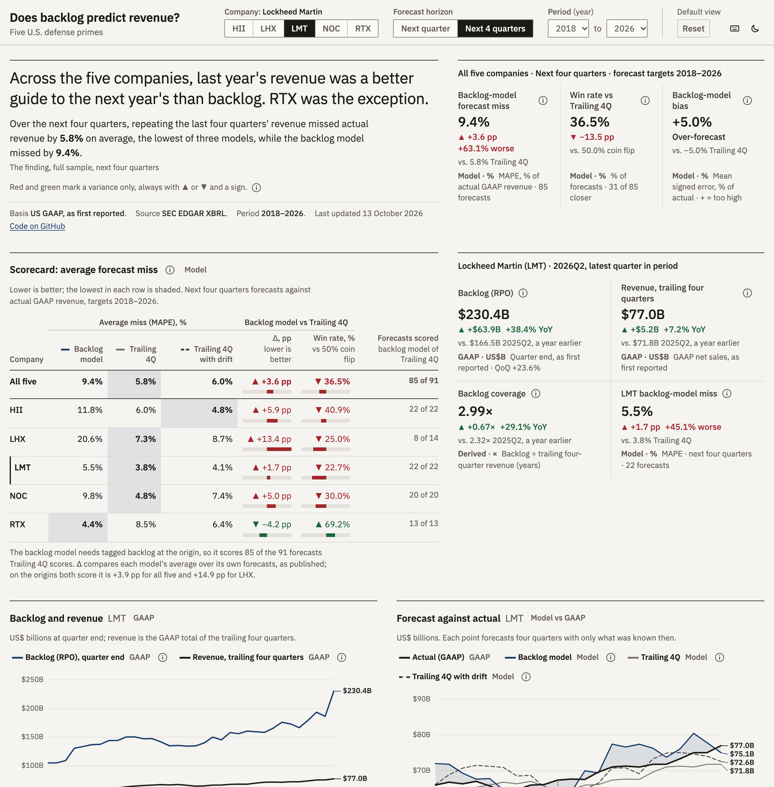

# Does backlog predict revenue? Five defense primes, 2018 to 2026

[Open the interactive dashboard](https://rishabbshankar226.github.io/Defense-Backlog-forecast/): pick a company, compare each model's forecasts with what happened, take apart a year's revenue change, stress next year's revenue, and check every figure against the filing-level rows behind it, reconciled to the cent.

[](https://rishabbshankar226.github.io/Defense-Backlog-forecast/)

I tested whether the backlog that HII, LHX, LMT, NOC and RTX report at quarter end forecasts their revenue over the following one and four quarters better than last year's revenue does, using only what their SEC filings showed at the time.

## Results

Backlog did not beat simple trailing revenue. Over the next four quarters, the backlog model missed actual revenue by 9.4% on average, against 5.8% for trailing four-quarter revenue and 6.0% for trailing revenue with drift. RTX was the exception, at 4.4% for backlog against 8.5% for trailing four-quarter revenue. The baselines also score 6 LHX origins where backlog is missing; on the origins all three models share, the ranking is the same.

MAPE by horizon, model and company (lower is better):

| Horizon | Model | ALL | HII | LHX | LMT | NOC | RTX |
|---|---|---:|---:|---:|---:|---:|---:|
| Next quarter (H1) | Backlog model | 9.9% | 13.7% | 13.6% | 6.2% | 9.0% | 8.3% |
| Next quarter (H1) | Seasonal naive | 7.3% | 7.3% | 7.8% | 5.4% | 6.3% | 11.2% |
| Next quarter (H1) | Seasonal naive with drift | 6.5% | 6.8% | 6.8% | 5.3% | 6.0% | 8.5% |
| Next four quarters (H4) | Backlog model | 9.4% | 11.8% | 20.6% | 5.5% | 9.8% | 4.4% |
| Next four quarters (H4) | Trailing 4Q | 5.8% | 6.0% | 7.3% | 3.8% | 4.8% | 8.5% |
| Next four quarters (H4) | Trailing 4Q with drift | 6.0% | 4.8% | 8.7% | 4.1% | 7.4% | 6.4% |

The backlog model's error was smaller than the naive baseline's (seasonal naive at H1, trailing 4Q at H4) at 45.0% of H1 origins and 36.5% of H4 origins. Its mean signed error was 5.4% at H1 and 5.0% at H4, where a positive value means it forecast too high.

| Win rate vs naive | ALL | HII | LHX | LMT | NOC | RTX |
|---|---:|---:|---:|---:|---:|---:|
| Next quarter (H1) | 45.0% | 40.0% | 18.2% | 52.0% | 39.1% | 68.8% |
| Next four quarters (H4) | 36.5% | 40.9% | 25.0% | 22.7% | 30.0% | 69.2% |

The backtest scores 100 backlog-model forecasts at H1 and 85 at H4. The naive models score more, because they need no backlog and LHX has quarters without it.

## Method

The design, windows and companies were fixed before any result existed, in [docs/PREREGISTRATION.md](docs/PREREGISTRATION.md) (commit `5ecc47a`). Nothing in it changed after I saw a number.

- **Data.** For each quarter I take backlog and revenue as first reported in a 10-Q or 10-K, so the backtest only sees what was known then. Backlog is the XBRL tag `RevenueRemainingPerformanceObligation`. Q4 revenue is the full year less the first nine months.
- **Backlog model.** Next quarter (H1): backlog times the average one-quarter conversion rate (next quarter's revenue over backlog) seen four and eight quarters earlier. Next four quarters (H4): backlog times the average four-quarter conversion rate over the four origins one to two years back.
- **Baselines.** At H1, "naive" is the seasonal naive (revenue in the same quarter last year) and "naive with drift" scales it by trailing growth. At H4, "naive" is the trailing four quarters of revenue and "trailing 4Q with drift" scales it by its own growth over the last year.
- **Scoring.** APE is the absolute error over actual revenue. MAPE is its mean; ALL pools every forecast. Win rate is the share of origins where the backlog model's APE is below the naive model's.
- **Bridge.** Each year's revenue change splits into a backlog effect, a conversion effect and their interaction, with no residual beyond rounding.

The Excel model ([output/defense_backlog_model.xlsx](output/defense_backlog_model.xlsx)) rebuilds every forecast with live formulas.

## Data

All figures come from SEC's XBRL companyfacts API, read as of 2026-10-13. Each company starts where its current form begins: LHX in 2020Q1, after the L3 and Harris merger closed in June 2019 and the six-month transition period it filed on a 10-KT, NOC in 2018Q3 after it bought Orbital ATK, and RTX in 2020Q2 after the UTC and Raytheon merger.

General Dynamics is left out. Its 10-Qs last tagged remaining performance obligations for the quarter ended September 2018, and its revenue facts since 2021 are full-year only, so quarterly backlog and revenue cannot be built from XBRL.

LHX's 10-Qs for the first three quarters of 2020 and 2021 never tag backlog at the quarter's own end: the 2020Q1 filing tags none, and the rest tag only the prior year end. Those six quarters have no backlog, so the backlog model skips every forecast that needs one. The baselines do not need backlog and keep those quarters.

`data/raw/MANIFEST.json` records the hash and size of each companyfacts file used.

## Limitations

- **XBRL backlog is remaining performance obligations, which may not match the backlog a company headlines.** For RTX they match by its own definition: "Backlog, which is equivalent to our remaining performance obligations (RPO) for our sales contracts" (10-K for 2025, accession 0000101829-26-000006). Other companies may count unexercised options or unfunded orders differently in their headline figure.
- **Implied bookings are a residual.** Backlog change plus revenue also absorbs cancellations, currency moves and acquisitions, so it is not a clean orders number.
- **Conversion is held constant.** The backlog model assumes the next conversion rate matches recent ones. Program mix and contract timing move it.
- **RTX's backlog includes commercial aerospace**, which follows airline demand rather than defense budgets.
- **The merger start dates shorten the sample.** LHX and RTX start in 2020 and NOC in 2018Q3. The first backtest origin is two years after each start, and later still for LHX's backlog model, which first has the inputs it needs at 2022Q4 (next quarter) and 2023Q3 (next four quarters).
- **H4 windows overlap.** Consecutive four-quarter forecasts share three quarters of actuals, so the H4 forecasts are far from independent and the pooled MAPE is less certain than its count suggests.
- **HII's tagged backlog jumps between 2018Q4 and 2019Q1**, from $23.0B to $40.6B. Forecasts made in 2020 average conversion rates from before and after the jump, and they are HII's largest backlog-model misses at both horizons. The same jump produces the large backlog effect in HII's 2020 bridge. I found no filing sentence giving the reason, so I describe it and stop there.

## Reproduce

```bash
uv venv --python 3.11 .venv
uv pip install --python .venv/bin/python -r requirements.lock
printf 'Your Name you@example.com\n' > ~/.sec_ua
make all
make test
```

`make data` fetches a companyfacts file only when it is missing from `data/raw/`, so later SEC filings never change a run.

Built by Rishabb Shankar, [rshankar.dev](https://rshankar.dev).
